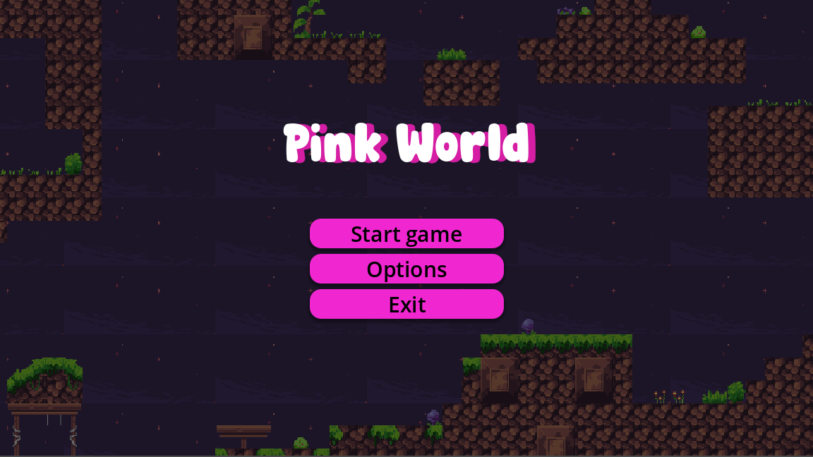
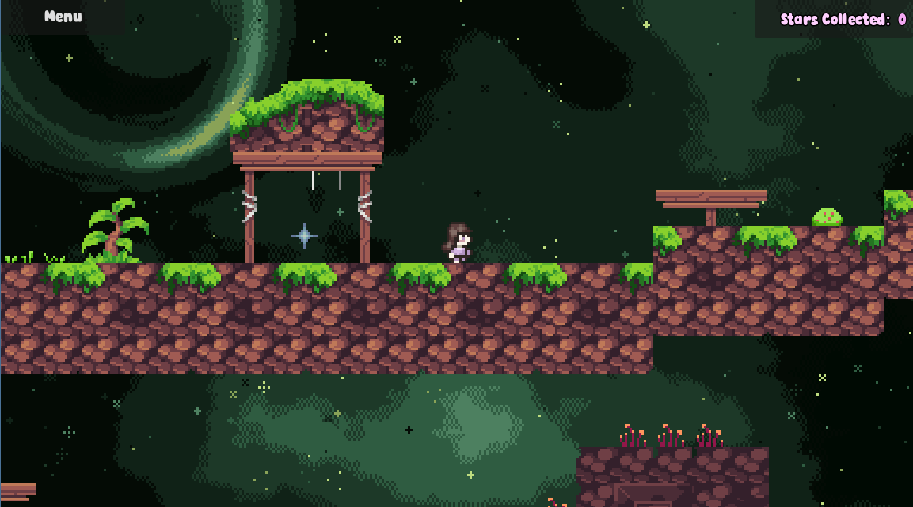
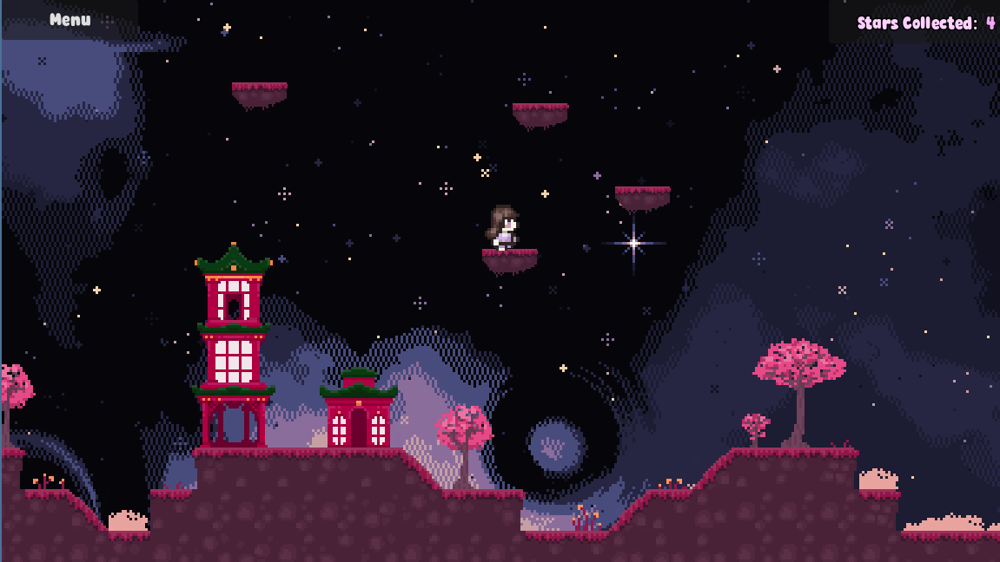
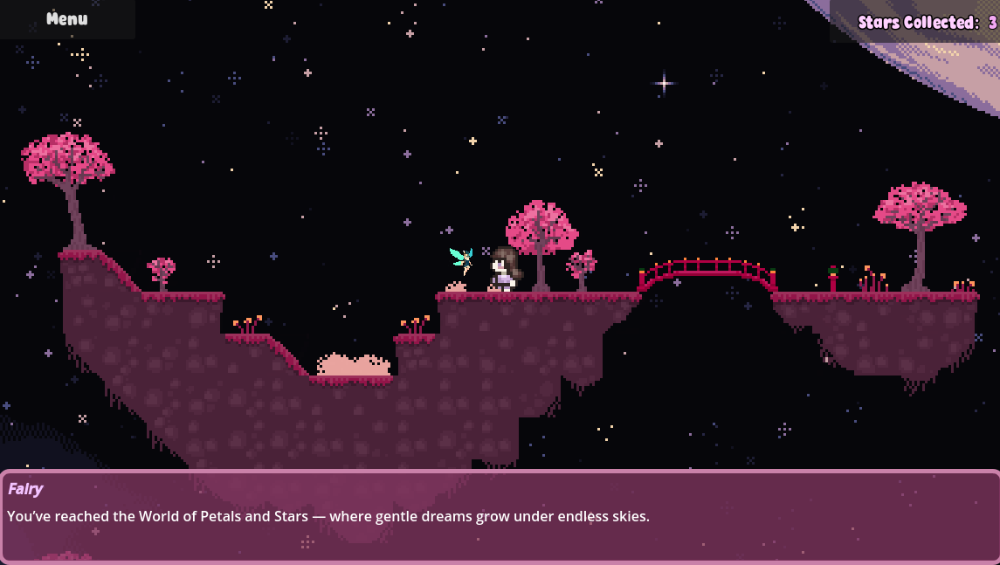
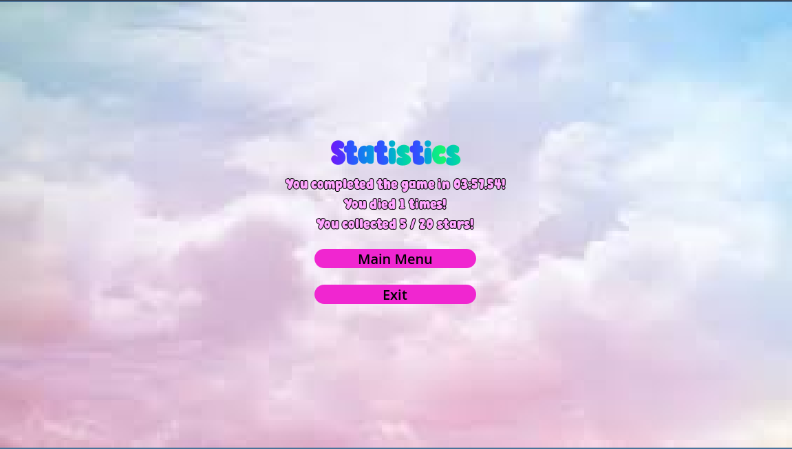

# Pink World – 2D Platformer Game

Pink World is a 2D platformer game developed using the **Godot Engine** as part of a university project.

The game features two levels, collectible items, and interactive gameplay mechanics.

## Screenshots

### Main Menu

### Level 1

### Level 2

### Gameplay Mechanics

### Statistics Screen

## Technologies
- Godot Engine
- GDScript
- Git / GitHub

## Features
- Player movement and collision mechanics
- Multiple levels
- Collectible star fragments
- UI elements and game menus

## Project Structure
assets/ – game assets and resources  
scenes/ – Godot scene files  
scripts/ – gameplay logic implemented in GDScript  
ui/ – interface elements

## Contributors
- Boyana Anastasova
- Stilyana Stoichkova

## Status
University project – further improvements possible.
