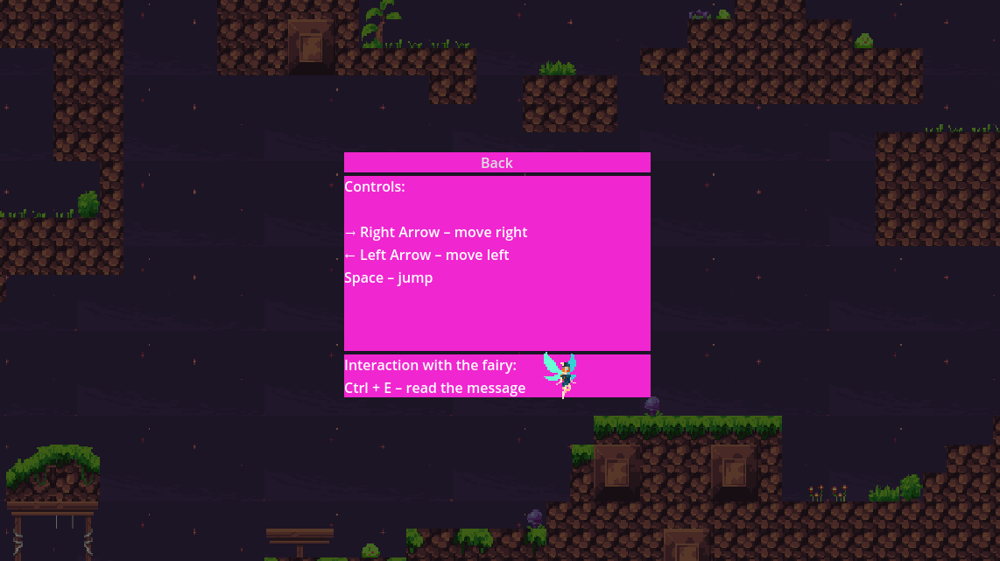
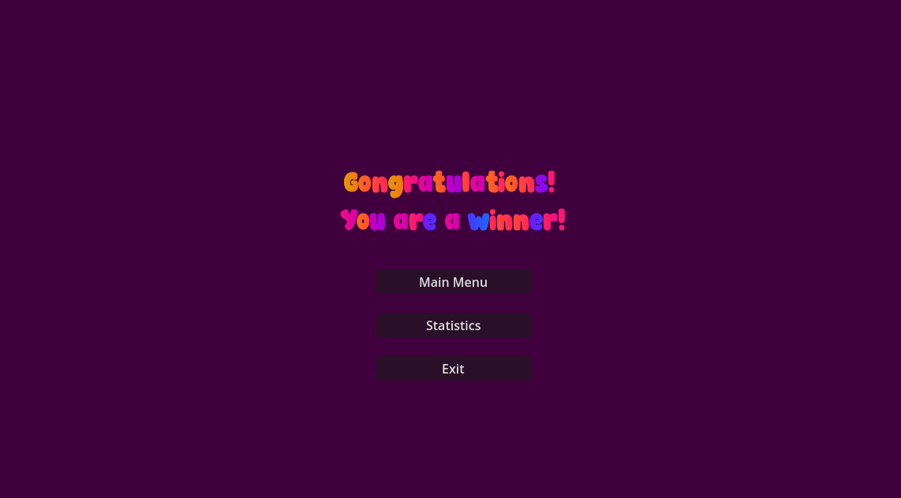

# Pink World – 2D Platformer Game

Pink World is a 2D platformer game developed using the **Godot Engine** as part of a university project.

The game features two levels, collectible items, and interactive gameplay mechanics.

## My Contributions — Stilyana Stoichkova

Pink World was developed as a collaborative university project. My individual contributions focused on level design, scene development, and user interface creation using Godot Engine.

**My contributions include:**

- **Level 1:** Designed and built the first playable level, including its platform layout, obstacles, and environmental elements.
- **Main Menu:** Created the main menu interface with Start Game, Options, and Exit buttons.
- **Options Menu:** Developed the interface displaying gameplay controls and interaction instructions.
- **Victory Screen:** Created the completion screen featuring navigation to the main menu, statistics, and exit options.

The remaining parts of the game were developed collaboratively or by my project teammate, Boyana Anastasova.

## Screenshots

### Main Menu — My Contribution

### Options Menu — My Contribution

### Level 1 — My Contribution

### Level 2

### Gameplay Mechanics

### Statistics Screen

### Victory Screen — My Contribution

## Technologies
- Godot Engine
- GDScript
- Git / GitHub

## Features
- Player movement and collision mechanics
- Multiple levels
- Collectible star fragments
- UI elements and game menus

## Project Structure
assets/ – game assets and resources  
scenes/ – Godot scene files  
scripts/ – gameplay logic implemented in GDScript  
ui/ – interface elements

## Contributors
- Boyana Anastasova
- Stilyana Stoichkova

## Status
University project – further improvements possible.
